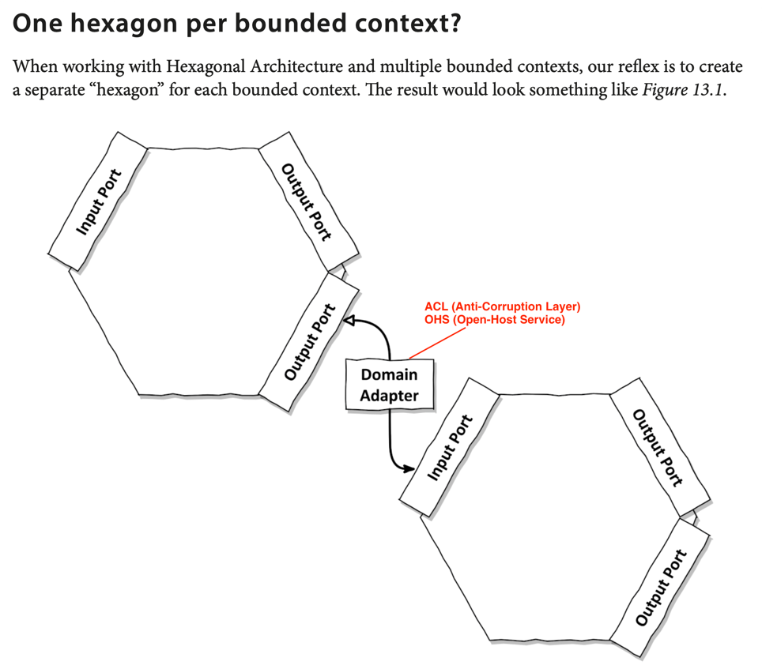
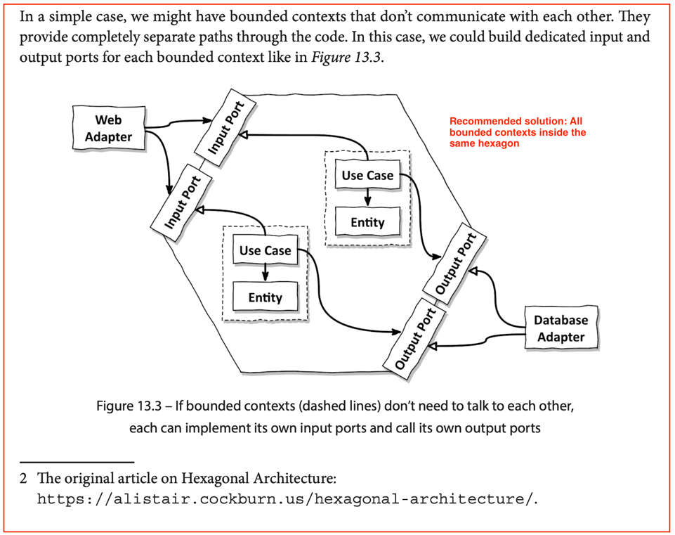

# Understanding the Architecture

One Hexagon per bounded context folder structure (not recommended for small teams and solo developers). This approach requires you translate domain events to integration events before sending them to the 'out' port of BC, then for the downstream BC to listen to the integration event in one of its 'in' ports, and finally translate the integration event to a command that is sent to the application layer of the BC interested in the event. A lot of translation taking place, and therefore a lot of boilerplate:



```
org.soldatenwohnen
│
├── catalog                             <-- BOUNDED CONTEXT 1 (Search & Discovery)
│   ├── adapter                         <-- Catalog's Outside World
│   │   ├── in (web)                    <-- Catalog Web Controllers
│   │   └── out (persistence)           <-- Catalog Repositories (catalog_items table)
│   │
│   ├── application                     <-- Catalog's Orchestration
│   │   ├── port (in/out)               <-- Catalog's Interfaces
│   │   └── service                     <-- Catalog's Use Cases (Application Services)
│   │
│   └── domain                          <-- Catalog's Business Logic
│       └── model
│           └── Listing.kt              <-- The "Listing" Aggregate (Photos, Price)
│
├── leasing                             <-- BOUNDED CONTEXT 2 (Contracts & Legal)
│   ├── adapter                         <-- Leasing's Outside World
│   │   ├── in (web)                    <-- Leasing Web Controllers
│   │   └── out (persistence)           <-- Leasing Repositories (lease_assets table)
│   │
│   ├── application                     <-- Leasing's Orchestration
│   │   ├── port (in/out)
│   │   └── service
│   │       └── CreateContractService.kt
│   │
│   └── domain                          <-- Leasing's Business Logic
│       └── model
│           └── LeaseAsset.kt           <-- The "Asset" Aggregate (Owner, Deposit)
│
├── scheduling                          <-- BOUNDED CONTEXT 3 (Viewings)
│   ├── adapter
│   ├── application
│   └── domain
│
├── shared                              <-- SHARED KERNEL (The "Commons")
│   ├── domain
│   │   ├── Money.kt                    <-- Value Object used by everyone
│   │   └── Address.kt                  <-- Value Object used by everyone
│   │
│   └── application
│       └── Command.kt                  <-- Shared Interface for commands
│
└── BuckpalApplication.kt
```

All bounded contexts inside the same hexagon (recommended approach until you realise that sharing event types between bounded contexts is polluting the downstream context's domain language)


```
com.buckpal.brokerage
│
├── adapter                         <-- OUTSIDE THE HEXAGON (Shared Infrastructure)
│   ├── in                          <-- Driving Adapters
│   │   └── web
│   │       ├── CatalogController.kt      (Points to Catalog Ports)
│   │       └── LeasingController.kt      (Points to Leasing Ports)
│   │
│   └── out                         <-- Driven Adapters
│       └── persistence
│           ├── CatalogPersistenceAdapter.kt  (Implements Catalog Output Ports)
│           ├── LeasingPersistenceAdapter.kt  (Implements Leasing Output Ports)
│           ├── CatalogJpaEntity.kt           (Keep DB tables separate!)
│           └── LeaseJpaEntity.kt
│
└── core                            <-- INSIDE THE HEXAGON (The Business Core)
│
├── catalog                     <-- BOUNDED CONTEXT 1
│   ├── port
│   │   ├── in
│   │   │   └── SearchListingsUseCase.kt
│   │   └── out
│   │       └── LoadListingPort.kt
│   ├── service
│   │   └── SearchListingsService.kt
│   └── domain
│       ├── Listing.kt
│       └── ListingPublishedEvent.kt  <-- The Domain Event
│
├── leasing                     <-- BOUNDED CONTEXT 2
│   ├── port
│   │   ├── in
│   │   │   └── GenerateContractUseCase.kt
│   │   └── out
│   │       └── SaveContractPort.kt
│   ├── service
│   │   ├── GenerateContractService.kt
│   │   └── CatalogEventListener.kt   <-- Listens directly to ListingPublishedEvent!
│   └── domain
│       └── LeaseAsset.kt
│
└── common                      <-- SHARED KERNEL
└── Money.kt
```